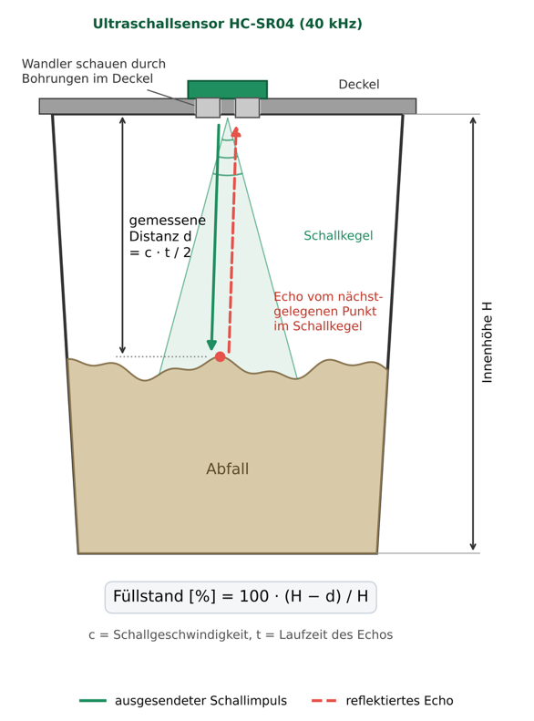
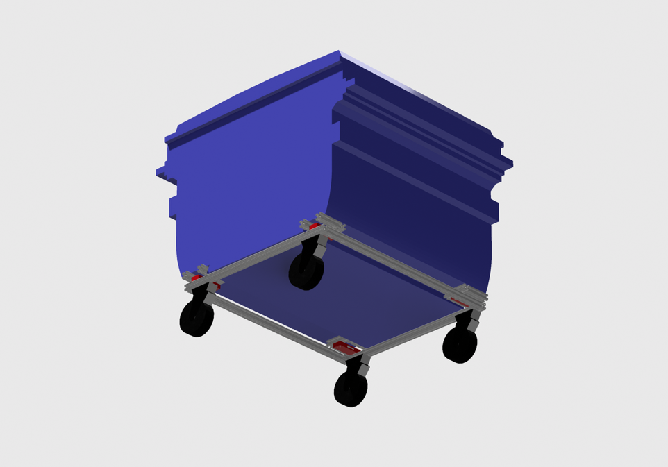
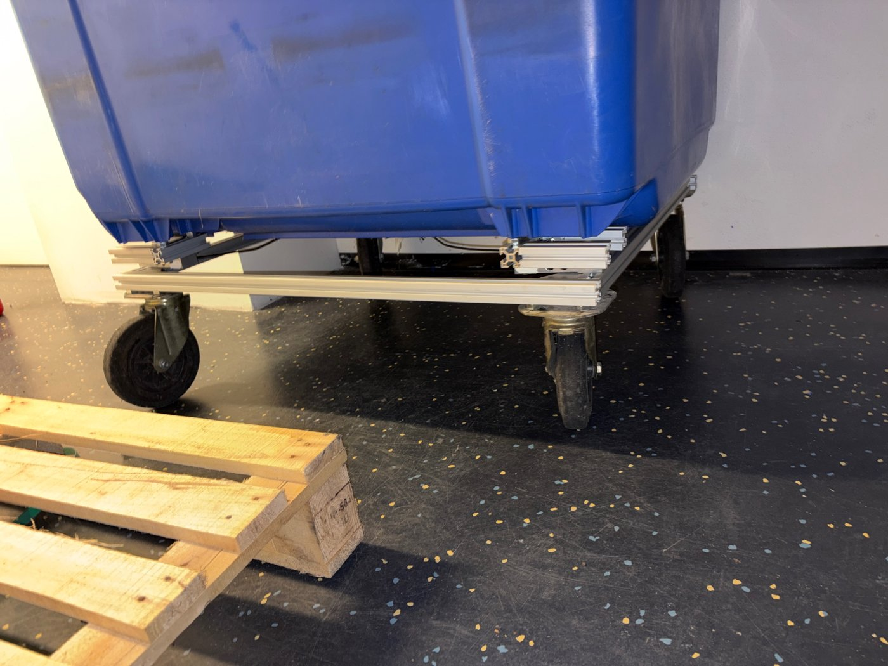

# Smart-Waste-Sensor

Universitätsprojekt der Universität Potsdam.

## Zielstellung

Entwicklung eines kostengünstigen, cloudunabhängigen Sensors zur automatisierten Erfassung des Füllstands von Abfallbehältern. Die Messwerte werden per LoRaWAN übertragen und bilden die Datengrundlage, um Behälteranzahl, Standorte und Leerungsintervalle am tatsächlichen Bedarf auszurichten.

## Projektstand

### Füllstand (✅)

Abstandsmessung per Ultraschall vom Deckel aus auf einem Heltec WiFi LoRa 32 V3 (ESP32-S3). Die Messwerte werden über LoRaWAN an The Things Network gesendet und von dort per MQTT an die Weiterverarbeitung übergeben.

Firmware: [`Arduino/heltec_v3_smartwaste_lorawan_final`](Arduino/heltec_v3_smartwaste_lorawan_final) (inkl. TTN-Payload-Decoder)

  

### Gewicht (🚧)

Gewichtsmessung über einen Rahmen mit Wägezellen und HX711 am ESP32 als mögliche Ergänzung zur Füllstandsmessung. Noch nicht getestet; der aktuelle Code liest noch nicht alle 4 Wägezellen aus.

Code: [`Arduino/esp32_hx711_parallelstahl100`](Arduino/esp32_hx711_parallelstahl100)

  
  

## Architektur

Datenverarbeitung, Speicherung und Dashboard: https://github.com/2bias2u/Smart-Waste
